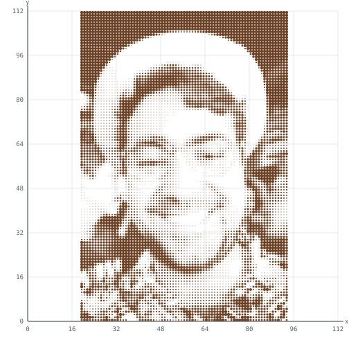

  

### Hi, I'm Tiago 👋

Software Engineer since 2017, currently at CompareCredit. I work mostly with **TypeScript, React and Next.js**: server-side rendering, data fetching, headless CMS (Sanity), CI and observability.

Most of my day-to-day development is AI-assisted, with Claude Code and MCP integrations.

Based in São Paulo, Brazil 🇧🇷 · [LinkedIn](https://www.linkedin.com/in/tiago-sanches-vieira/)
